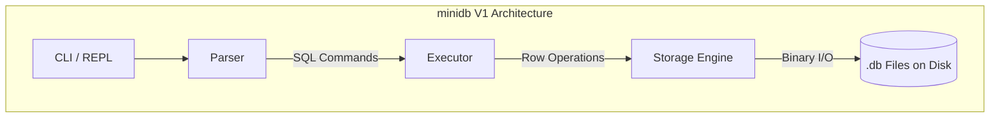
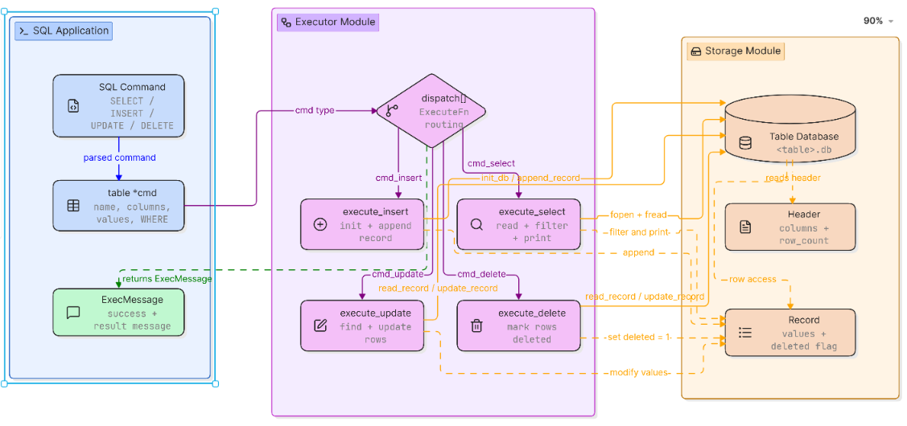
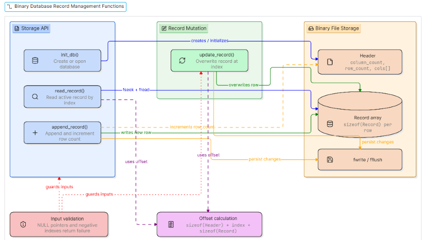
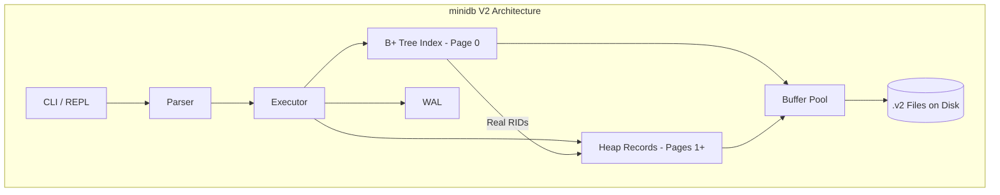
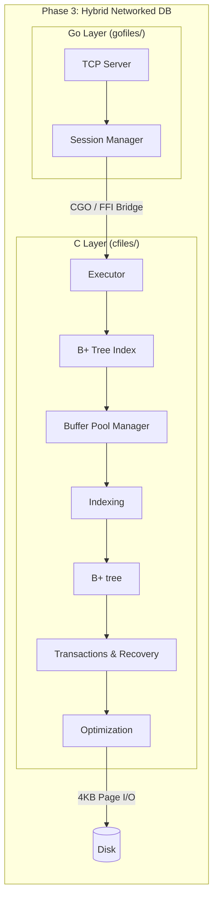

# miniSQL

A relational database built from scratch to understand database internals, storage engines, and buffer pool management. 

Currently, `minidb` features a C-based SQL CLI, a custom parser, a persistent V1 flat-file engine, and a V2 paged engine with B+ tree indexing.

## Current Architecture (Version 1 - Flat File)
Right now, `minidb` operates entirely locally via a command-line interface.

   
  

1. **CLI / REPL (`cli.c`)**: Reads raw SQL strings from standard input.
2. **Parser (`parser.c`)**: Tokenizes the SQL string and extracts the command type (`SELECT`, `INSERT`, `UPDATE`, `DELETE`), columns, values, and `WHERE` clauses into a `table` struct.
3. **Executor (`executor.c`)**: Maps the parsed command to the correct execution function. It handles the logic of matching `WHERE` conditions and formatting output for the terminal.
4. **Storage Engine (`storage.c`)**: Manages permanent disk I/O. 
   - Tables are stored as raw binary files (e.g., `cars.db`).
   - The file begins with a `Header` struct tracking row and column counts.
   - Records are appended sequentially as fixed-size structs.
   - **Deletions** use *tombstones* (a `deleted = 1` flag is set on the record) instead of shrinking the file, allowing fast O(1) in-place updates.

### Supported Features
- **Persistent Storage**: Data survives between runs.
- **Insert**: `insert into cars values audi 23`
- **Select**: `select * from cars` / `select * from cars where age = 24`
- **Update**: `update cars set age = 25 where name = audi`
- **Delete**: `delete from cars where age = 24`

## Current Architecture (Version 2 - Paged B+ Tree)
The V2 engine is used by the current executor and stores the index and rows in the same `.v2` database file.

1. **B+ Tree Index (`btree.c`)**: Stores the indexed key and a real record ID containing the heap page and slot.
2. **Heap Storage (`page.c`)**: Stores fixed-size V2 row records in slotted pages. Page 0 is reserved for the B+ tree root; heap records begin at page 1.
3. **Buffer Pool (`buffer.c`)**: Caches database pages and flushes dirty pages to disk when the CLI exits.
4. **Executor (`executor.c`)**: Inserts, reads, updates, and deletes rows through both the B+ tree and heap storage.
5. **Write-Ahead Log (`wal.c`)**: Records committed and aborted insert transactions.

### V2 Supported Features
- **Insert**: `insert into users ( id , name ) values ( 2 , bob )`
- **Select**: `select * from users` / `select * from users where id = 2`
- **Update**: `update users set name = alice2 where id = 1`
- **Delete**: `delete from users where id = 2`
- **Real Row Data**: `SELECT *` displays stored columns and values rather than internal RID fields.
- **Duplicate Keys**: Duplicate index keys are rejected.
- **Column Limit**: V2 currently stores up to four columns per row.

V2 database files created by the earlier mock-RID prototype are not compatible with the current heap format. Remove the old `.v2` and `.v2.log` files once before using the new format.

---

## Planned Architecture (Version 3)

To evolve from the local V2 engine into a networked database, the architecture is designed to grow bottom-up into a hybrid C/Go system.

